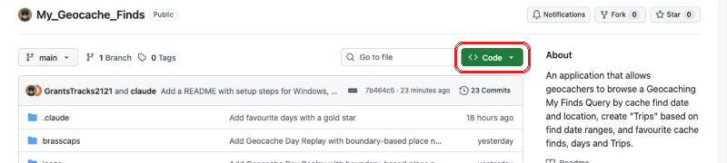
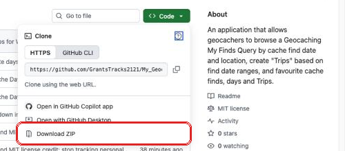

# My Geocache Finds

A personal web app that turns your Geocaching.com "**My Finds**" Pocket Query
into caching days you can explore on a map:

- **Day Replay**: replay any caching day, find by find, on a map, with your logs
- **Browse by Date** and **Browse by Location**: by year and month, or country,
  province or state and town
- **Trips**: name a date range and see its caching days together
- **Favourites**: star the days, trips and caches you like best
- **Search**: find any cache by name or GC code, any place, any trip, or a
  word you wrote in a log
- **My Places**: name your own areas (a park, a neighbourhood, a hiking area) so
  day titles use them

The app runs entirely on your own computer in a browser. Your finds, trips and notes stay in
the app's folder and are never sent anywhere. The only thing it fetches from
the internet is the map itself (from OpenStreetMap).

It works on **Windows, macOS and Linux** and is meant to be used on a desktop computer or laptop.

---

## What you need

- **Python 3.9 or newer.** No other software or add-ons are needed, except one
  small package on Windows (step 1).
- **A web browser**: Chrome, Edge, Firefox or Safari.
- **A Geocaching.com Premium membership**, to get your My Finds Pocket Query.
- **About 600 MB of free disk space** if you want town names in day titles
  (optional, step 5).

---

## 1. Install Python

### Windows 10 or 11

1. Download Python from <https://www.python.org/downloads/> and run the installer.
   If it shows a checkbox **Add python.exe to PATH**, tick it.
2. Open **Terminal** (or Command Prompt) from the Start menu and check it worked:
   ```
   py --version
   ```
   You should see something like `Python 3.13.1`.
3. Install the time zone data, which Windows doesn't include:
   ```
   py -m pip install tzdata
   ```
   Without it the app still works, but it can't tell what time it was where
   each cache was found, so a find logged late in the evening can land on the next day.

On Windows the command is **`py`**. Wherever the app or these instructions
say `python3`, type `py` instead.

### macOS

Recent Macs may already have Python. In **Terminal** (Applications ▸ Utilities) type:
```
python3 --version
```
If it isn't there, or is older than 3.9, install it from
<https://www.python.org/downloads/>.

### Linux

Almost every Linux distribution already has Python 3. Check with:
```
python3 --version
```
If it's missing, install it with your package manager, for example
`sudo apt install python3` (Ubuntu, Debian) or `sudo dnf install python3` (Fedora).

---

## 2. Get the app

You download the app as one zip file, the same way you'd download any file, and unzip it into a folder.

### Download the zip file

1. Go to the app's page on GitHub:
   **<https://github.com/GrantsTracks2121/My_Geocache_Finds>**
   (If you're reading this on GitHub, you're already there: scroll back to
   the top of the page.)
2. Above the list of files, click the green **Code** button.

   

3. A menu opens. Click **Download ZIP** at the bottom of it. You can ignore
   everything else in the menu.

   

4. Your browser saves a file named **My_Geocache_Finds-main.zip**, usually in
   your **Downloads** folder.

### Unzip it into a folder

The zip file holds one folder, **My_Geocache_Finds-main**. That folder is the
app. Put it somewhere you'll find it again, such as your **Documents** folder.
Everything the app saves (your trips, favourites and so on) is saved in this
folder too.

**Windows 10 or 11**

1. Open **File Explorer** and go to your **Downloads** folder.
2. Right-click **My_Geocache_Finds-main.zip** and choose **Extract All…**
3. In the window that opens, click **Browse…**, choose your **Documents**
   folder, and click **Select Folder**.
4. Click **Extract**. The folder **My_Geocache_Finds-main** is now in Documents.

**macOS**

1. Open **Finder** and go to your **Downloads** folder.
2. Double-click **My_Geocache_Finds-main.zip**. A folder named
   **My_Geocache_Finds-main** appears next to it. (Safari sometimes does this
   for you, so the folder may already be there.)
3. Drag the **My_Geocache_Finds-main** folder into your **Documents** folder.

**Linux**

1. Open your file manager and go to your **Downloads** folder.
2. Right-click **My_Geocache_Finds-main.zip** and choose **Extract Here**.
3. Move the **My_Geocache_Finds-main** folder into your **Documents** folder.

Or, in a terminal: `unzip ~/Downloads/My_Geocache_Finds-main.zip -d ~/Documents`

**Check:** open the **My_Geocache_Finds-main** folder. You should see files
such as `serve.py`, `index.html` and `README.md` straight away. If instead you
see another folder with the same name, open that one: that's the app's folder.

You can rename the folder if you like, for example to **My Geocache Finds**.

### If you use git

You can clone the app instead of downloading the zip:
```
git clone https://github.com/GrantsTracks2121/My_Geocache_Finds.git
```

---

## 3. Start the app

Open a terminal **in the app's folder**:

- **Windows 11:** in File Explorer, open the folder, right-click an empty space
  and choose **Open in Terminal**.
- **macOS:** in Finder, right-click the folder and choose
  **Services ▸ New Terminal at Folder**. Or type `cd ` in Terminal, drag the
  folder onto the window and press Return.
- **Linux:** most file managers have **Open in Terminal** on the right-click
  menu. Or `cd` to the folder.

Then start the app:

| Windows | macOS and Linux |
|---|---|
| `py serve.py` | `python3 serve.py` |

You'll see `Serving this folder at http://localhost:8002/`. Open
**<http://localhost:8002/>** in your web browser. That's the Dashboard.

Leave the terminal window open while you use the app. To stop it, click in
the terminal and press **Control-C**. Next time, just run the same command
again.

Only your own computer can open the app. Nobody else on your network or the
internet can reach it.

---

## 4. Load your finds

1. On Geocaching.com, go to **Pocket Queries** (<https://www.geocaching.com/pocket/>).
2. Under **My Finds**, click **Add to Queue**. Geocaching.com prepares it in a
   few minutes to an hour, and you can run it once every three days.
3. On the **Pocket Queries Ready for Download** tab, download the .zip file.
4. Drag the .zip file onto the **My Finds Pocket Query** box at the bottom of
   the Dashboard, or click the box to choose the file. There's no need to unzip it.

The app reads every find and builds your caching days. This takes about half a
minute. Do the same whenever you want to bring it up to date with your newest
finds.

---

## 5. Optional: town names in day titles

Without this step, day titles show only the province or state, such as
"Alberta". With it, they name the towns, such as "Devon & near Edmonton, Alberta",
and each find's local time zone comes from the nearest town.

In the terminal, in the app's folder (stop the app with Control-C first, or
open a second terminal):

| Windows | macOS and Linux |
|---|---|
| `py build_places.py` | `python3 build_places.py` |

This downloads the GeoNames list of the world's towns (about 400 MB) and builds
a lookup file from it. It only needs to be done once. Then load your My Finds
file again (step 4) so the titles use the town names.

### Canada: city and county limits are built in

For finds in Canada, the app comes with Statistics Canada's municipal
boundaries, so a cache is credited to the town it is really in. For example, a
cache in Sherwood Park is credited to Sherwood Park, not to nearby Edmonton.
There's nothing extra to download: once you've built the town names above,
the boundaries are used automatically.

---

## The Brass Cap Cache - It's a Niche Alberta Thing

**If "Brass Caps" are a new concept to you, you can safely skip this section.**

In the past, if you found "Brass Caps" in Alberta and logged them on [The Brass Cap Cache](https://www.geocaching.com/geocache/GC43F3_brass-cap-cache-smith-dorrien-rd) page, or currently find them and log them as notes on the [Brass Cap Cache - A Memorial Puzzle](https://coord.info/GC72DVJ) page, you will want to read this section.

### Some Background

The [Brass Cap Cache](https://www.geocaching.com/geocache/GC43F3_brass-cap-cache-smith-dorrien-rd) was a "roving virtual" cache owned by [outforthehunt](https://www.geocaching.com/p/?guid=a4eb2247-f983-4f25-aa4e-03a36a9c094f). The location of the cache, one of thousands of brass survey markers located across the province, would be periodically changed on the same cache page, and cachers could log multiple finds on this one cache.

In 2017, Groundspeak disallowed the practice of logging multiple finds for one cache, and the "Brass Cap Cache" was eventually archived. The current "My Finds" pocket query, therefore, only records the last brass cap location in Kananaskis listed on the page before it was archived.

### Why include brass cap finds?

For example, if you found a cap on a street corner in Edmonton in the past, your "My Finds" will have a record of the find, but the map will display the location of that find at the only place it knows the GC43F3 cache to be: in Kananaskis.

Follow the process below to gather your Brass Cap find data.

### How to Gather Your Brass Cap Find Data

A Calgary cacher [van der Decken](https://www.geocaching.com/p/?guid=7116f780-8a80-4287-8122-0291974cb7b8) maintains a wonderful "Stats & Logs" site that contains brass cap find statistics, both historical (at the [Brass Cap Cache](https://www.geocaching.com/geocache/GC43F3_brass-cap-cache-smith-dorrien-rd)) and current (at [Brass Cap Cache - A Memorial Puzzle](https://coord.info/GC72DVJ)).

Here's how to extract your Brass Cap find stats:

1. In a browser, open the [Brass Cap Cache • Stats & Logs](https://brasscap.albertabattlecache.ca/) site.
2. Click on the "Cacher Stats" link on the right-hand side of the page.
3. Find your name on the list of finders and click it to view all your brass cap Finds.
4. On your stats page, copy its address from your browser's address bar. It looks like https://brasscap.albertabattlecache.ca/cacherbreakdown/….html.
5. On the My Geocache Finds Dashboard, open Settings and scroll to the bottom, to Alberta Brass Cap Cache.
6. Paste the address into the box and click "Load brass caps".

The app reads your finds from that page and rebuilds your caching days. The first time, this can take a few minutes. When it's done, you'll see your caching name and how many brass cap finds it read.

If you continue to find brass caps and post notes on the [Brass Cap Cache - A Memorial Puzzle](https://coord.info/GC72DVJ) cache page, you need to repeat this process periodically to update your finds.

---

## Searching your finds

Every page has a search box: at the top right, or above the list on the map
pages. Press **/** on any page to jump straight to it. Start typing, and
results show up in groups:

- **Places**: countries, provinces and states, towns, neighbourhoods and your
  own My Places, with how many finds each has. Opens Browse by Location there.
- **Trips**: by name or by a word in the trip's note. Plays the trip.
- **Caches**: by name or GC code. Opens that caching day with the cache's log.
- **Mentioned in your logs**: finds whose log contains what you typed (from 3
  letters).

Capitals and accents don't matter, so "quebec" finds Québec. Use the arrow
keys and Return to open a result, or Escape to close the list.

---

## What stays on your computer

Everything you add is saved in the app's folder:

| File or folder | What it holds |
|---|---|
| `*.gpx` | your My Finds Pocket Query |
| `data/days.js` | your caching days, built from it |
| `trips.json` | your trips |
| `favorites.json` | your starred days, trips and caches |
| `places.json` | your My Places |
| `settings.json` | your Dashboard settings |
| `profile/` | your Dashboard picture and background |
| `brasscaps/brasscaps.json` | your Alberta Brass Cap Cache finds |

To back up your data, copy these. To move the app to a new folder or computer,
copy the whole folder.

---

## Troubleshooting

**"py" or "python3" is not recognized.**
Python isn't installed, or wasn't added to PATH. Run the Python installer
again and tick **Add python.exe to PATH** (Windows), then open a new terminal.

**A yellow bar says "this isn't serve.py".**
The pages were opened some other way, for example by double-clicking
`index.html`. Start the app with `py serve.py` or `python3 serve.py` and open
<http://localhost:8002/>.

**"Address already in use" when starting.**
The app is already running in another terminal window, or something else is
using port 8002. Use the running copy, or start it on another port with
`py serve.py 8003` and open <http://localhost:8003/>.

**After loading finds, the terminal says there's no time zone data.**
On Windows, run `py -m pip install tzdata`, then load your My Finds file again.

**The map is blank.**
The map comes from OpenStreetMap, so it needs an internet connection.
Everything else works offline.

---

## Known limits

- Day titles leave out **Canada** as the "home" country, and name every other
  country. For now, the home country is set in `build_days.py` (`HOME_COUNTRY`).

---

## Credits

- Maps © [OpenStreetMap](https://www.openstreetmap.org/copyright) contributors
- Place names: [GeoNames](https://www.geonames.org), CC BY 4.0
- Canadian boundaries: Statistics Canada, 2021 Census Boundary Files,
  Statistics Canada Open Licence
- Brass cap locations: [Alberta Brass Cap Cache stats](https://brasscap.albertabattlecache.ca)
- Cache type icons and the app icon: [c:geo](https://github.com/cgeo/cgeo), Apache License 2.0
- [Leaflet](https://leafletjs.com) (BSD 2-Clause),
  [marked](https://github.com/markedjs/marked) (MIT),
  [DOMPurify](https://github.com/cure53/DOMPurify) (Apache 2.0 / MPL 2.0)

Geocaching and Pocket Queries are trademarks of Groundspeak, Inc. This app is
not made by or connected with Geocaching.com.

This application was created with Anthropic's Claude Desktop.

## License

© 2026 Grant S. Wilson. Released under the [MIT License](LICENSE).
